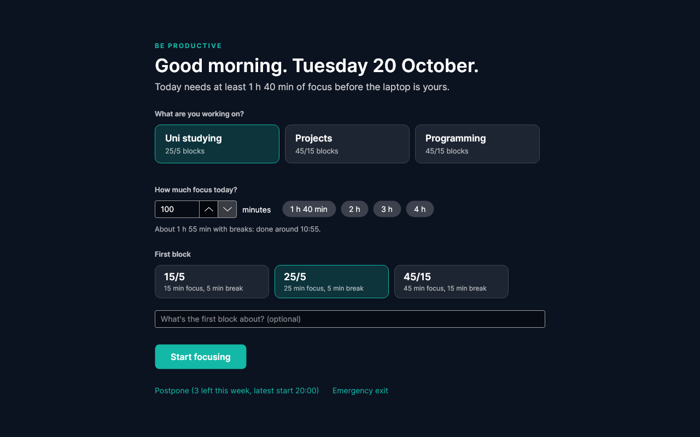
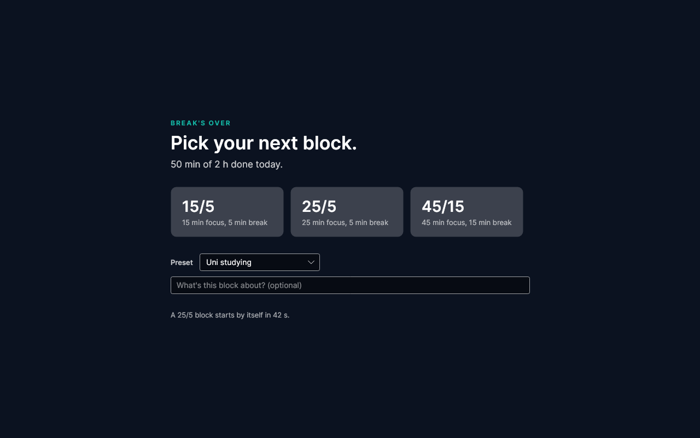
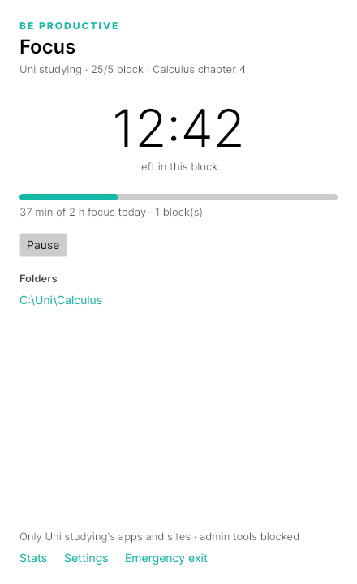
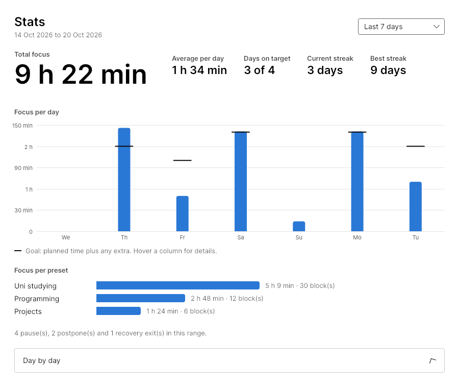
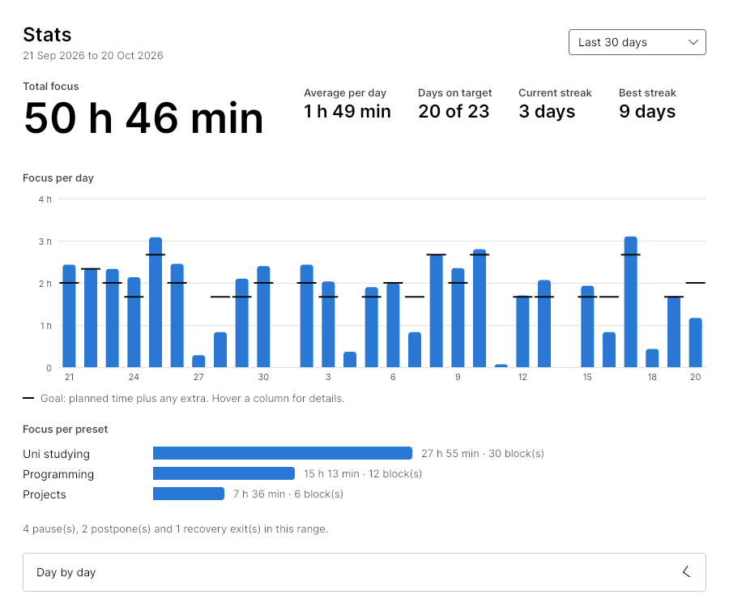

# Be Productive

A personal focus app for Windows: until you've done your daily focus time, the laptop is limited to the apps and sites you need for work. See [docs/design.md](docs/design.md) for the full design.

**Status: steps 1–5 of the [build order](docs/design.md#10-build-order).** So far there are:
- recovery codes, dry-run mode and the safety net
- the session engine (gate, pomodoro blocks, breaks, tracking)
- the desktop app: start screen, dashboard, next-block prompt, notifications, settings, stats and tray icon

Enforcement (step 4) is built: during focus the service kills programs that aren't allowed, blocks the distraction domains in the hosts file, and sets the Chrome and admin-tool policies — all through the step-1 safety net, and **off by default** (`Enforcement:DryRun` is `true`, so it only logs until you turn it on). The remaining step is the tamper-resistance layer (step 6, self-protection, watchdog, uninstall lock), described for a third party in **[docs/handoff-enforcement.md](docs/handoff-enforcement.md)**.

## Layout

| Path | What it is |
|---|---|
| `src/BeProductive.Core` | Everything not tied to one OS: the session engine, SQLite storage, the pipe protocol, recovery codes, the enforcement switch, the change journal and restore |
| `src/BeProductive.Windows` | Windows implementations (registry, hosts file, DNS flush) |
| `src/BeProductive.Service` | The background service (a Windows Service): runs the session clock and answers the pipe |
| `src/BeProductive.App` | The desktop app (Avalonia): start screen, dashboard, next-block prompt, settings, tray icon |
| `src/BeProductive.Cli` | `bp`, a command-line tool: the same commands as the app, plus setup and safety |
| `tests/BeProductive.Core.Tests` | Unit tests for everything in Core |
| `tests/BeProductive.App.Tests` | Headless UI tests; they also save screenshots of every screen |
| `scripts/restore.ps1` | Emergency undo. Keep a copy on a USB stick |
| `scripts/install.ps1` | Dev helper to install the service, the app (started at sign-in) and the CLI |

## Getting started (Windows)

1. Install the [.NET 8 SDK](https://dotnet.microsoft.com/download/dotnet/8.0).
2. Build and test:
   ```powershell
   dotnet build
   dotnet test
   ```
3. Run the service in a console window (Ctrl+C stops it), then the app:
   ```powershell
   dotnet run --project src/BeProductive.Service
   dotnet run --project src/BeProductive.App
   ```
   Or install everything for real from an admin terminal with `.\scripts\install.ps1`. That sets up the service as a Windows service, starts the app at every sign-in, and installs `bp` into `C:\Program Files\BeProductive\Cli`.
4. Use the CLI (from an admin terminal, because the state lives in `C:\ProgramData\BeProductive`):
   ```powershell
   dotnet run --project src/BeProductive.Cli -- status
   dotnet run --project src/BeProductive.Cli -- codes init
   ```

## Using it

### The app

- **Start screen.** While today isn't planned, a full-screen start screen covers everything and can't be closed. There you pick a preset, plan the focus time (at least the minimum, with an estimate of when you'll finish), choose the first block and start. From there you can also postpone, or use a recovery code.
- **Dashboard.** A small window with the countdown, today's progress and what can be done right now: pause and resume, cut a break short, switch preset, add or stop extra time, and open the preset's folders. Closing it keeps the app in the tray.
- **Next block.** When a break ends, a full-screen prompt asks for the next block's length. If you don't pick one within 60 s, the preset's default starts.
- **Notifications.** A sound and a note in the corner when a break starts and when the day's time is done.
- **Settings.** Edit presets (apps, sites, folders, terminals) and the daily minimums. Stricter changes apply at once; looser ones from tomorrow, and the window shows what's waiting.
- **Stats.** From the dashboard or the tray. For the last 7 days, 30 days or 12 months it shows:
  - total focus, the average per day, days on target, and the current and best streak
  - a chart of focus per day (per month for the year), with each day's goal marked; hover a column for details
  - focus per preset
  - pauses, postpones and recovery exits
  - a day-by-day table

  Streaks count days on target (or free days) in a row. Days with nothing recorded are skipped, and today only counts once it's done.
- **Tray icon.** Open, Stats, Settings and Quit. Quit only works once the planned time is done.

Screenshots (rendered by the UI tests; regenerate with `SCREENSHOT_DIR=docs/screenshots dotnet test`):

| Start screen | Next block | Dashboard |
|---|---|---|
|  |  |  |

| Stats (7 days) | Stats (30 days) |
|---|---|
|  |  |

### The service and the CLI

The service owns the day: it runs the clock every second, keeps its state in `C:\ProgramData\BeProductive\be-productive.db` (so restarts and reboots carry on) and answers commands over the named pipe `\\.\pipe\BeProductive`. The `bp` tool is one client; the UI (step 3) will be another.

```powershell
bp status                        # where the day stands
bp presets                       # uni, projects, programming
bp stats 30                      # focus per day and per preset (default: 7 days)
bp plan uni 120 25 Calculus 4    # plan 120 min with 25/5 blocks and start (the note is optional)
bp postpone 16:30                # or postpone the start (3 per week, until 20:00)
bp pause / bp resume             # pause the running block (10 min at most, then it resumes)
bp next 45                       # after a break (or to cut it short), start the next block
bp switch programming            # switch preset during a break
bp extend 60 25                  # once the planned time is done, add extra time
bp stop                          # stop extra time (planned time can't be stopped)
bp exit <recovery code>          # end today's lock; the day counts as failed
```

The rules (minimum per weekday, long breaks, the 04:00 day reset and so on) can be changed in the `Sessions` section of `settings.json`. See [docs/settings.example.json](docs/settings.example.json).

## Safety first

The app makes changes that could lock you out of your own PC, so every one of them goes through these safeguards:

- **Dry run is on by default.** `Enforcement:DryRun` is `true`, so the service only *logs* what it would block. Turn it off only when testing enforcement on purpose.
- **Panic file.** While `Enforcement:PanicFileEnabled` is `true`, creating a panic file switches live enforcement off, and everything applied is undone within 30 s. Two locations work: `C:\ProgramData\BeProductive\PANIC`, and `C:\Users\Public\BEPRODUCTIVE-PANIC.txt` — the second needs no admin rights and can be made in Explorer (New → Text Document), so it's the reliable escape even when the service is blocking terminals.
- **Change journal.** Every change is written to `C:\ProgramData\BeProductive\journal.json` *before* it's made, together with what was there before. The service undoes everything when it stops, at its next start after a crash, and whenever a change's lease (15 min by default) runs out without being renewed.
- **`bp restore`** undoes everything listed in the journal.
- **`scripts/restore.ps1`** is the last resort. Run it as admin: it writes a panic file first (so a running service stops enforcing and can't close its own window), then disables and hard-stops the service, undoes the journal, cleans the hosts file and the policies, and flushes DNS:
  ```powershell
  powershell -ExecutionPolicy Bypass -File .\scripts\restore.ps1
  ```
- **Safe Mode** always works: the service doesn't run there, so it's the safe place to run `restore.ps1` if a live session keeps closing your terminal.

## Recovery codes

- `bp codes init` creates the first 10 codes and shows them **once**, for your friend to write down. The PC keeps only hashes.
- `bp exit <code>` uses one to end today's lock. Each works once, and none is used up when nothing is locked.
- With 3 or fewer left you're offered a new set (`bp codes regenerate`). Using the last one sends a new set automatically, and the service keeps retrying every 5 minutes until it goes through.
- New sets are emailed to your friend and never shown on screen. The old codes keep working until the email is confirmed sent.

Email goes through [Resend](https://resend.com). Copy [docs/settings.example.json](docs/settings.example.json) to `C:\ProgramData\BeProductive\settings.json` and fill in:
- **`ApiKey`:** create a *sending-only* key.
- **`From`:** an address on a domain you've verified with Resend.
- **`To`:** your friend's address.
