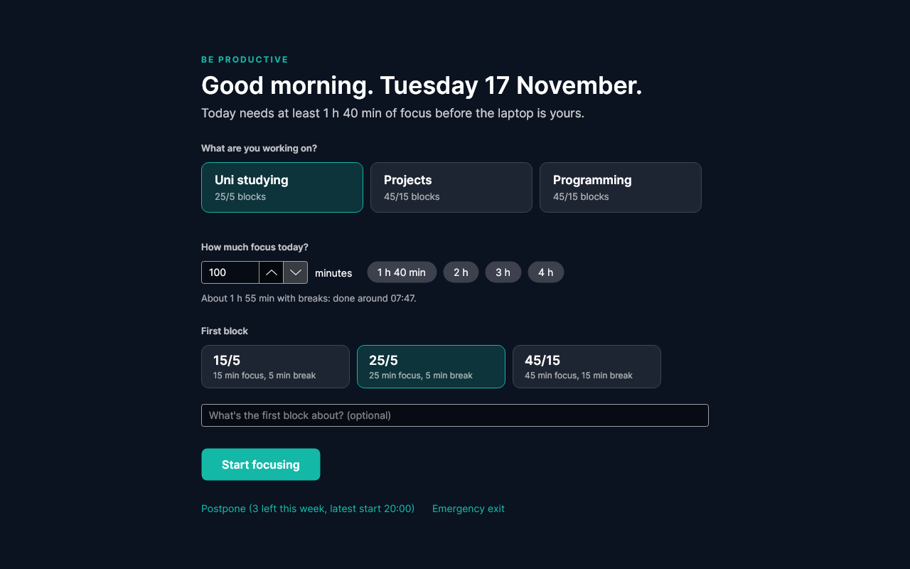

# Be Productive on Linux

**Status: first working port, not yet tested on a real desktop.** The Linux build compiles, its 48 Linux
tests pass, and the service runs as root on Linux: live blocking was tested end to end in a container
(hosts file, Chrome policies, the journal, undo on stop, recovery after `kill -9`, and `restore.sh`). The
real app ran under X11 and showed the gate. What has **not** been run yet is a real desktop session
(GNOME/KDE with logind), so process killing and the watchdog relaunch have only been tested against a fake
`/proc` and fake logind files. **Keep it in dry run first** and watch the log before going live (see
"First run" below).



## How it maps from Windows

| Windows | Linux | Code |
|---|---|---|
| Windows Service as SYSTEM, `sc failure` restart | systemd unit as root, `Restart=always`, `Type=notify` | `scripts/linux/be-productive.service`, `AddSystemd()` |
| Named pipe `\\.\pipe\BeProductive`, ACL for signed-in users | Unix socket `/run/be-productive/be-productive.sock`, mode 0666 | `IpcProtocol.PipeName`, `IpcServerWorker.CreateUnixPipe` |
| `C:\ProgramData\BeProductive` | `/var/lib/be-productive` (systemd `StateDirectory`) | `AppPaths` |
| `drivers\etc\hosts` + `ipconfig /flushdns` | `/etc/hosts` + `resolvectl flush-caches` (or nscd, or nothing) | `LinuxHostsFile`, `LinuxDnsCache` |
| Chrome policies in `HKLM\SOFTWARE\Policies\Google\Chrome` | Our own file `be-productive.json` in `/etc/opt/chrome/policies/managed/` and `/etc/chromium/policies/managed/` | `JsonPolicyFiles`, `LinuxEnforcementPolicies` |
| Task Manager / regedit / cmd disabled by policy | No such policy: system monitors are ended by name (`Enforcement:AdminToolApps`) | `EnforcementOptions.AdminToolApps`, `EnforcementPlanner` |
| Console session via `WTSGetActiveConsoleSessionId` | The active logind session on `seat0` of type x11/wayland, class `user` (read from `/run/systemd/sessions`) | `LinuxUserSession` |
| Processes in the user's session | Processes owned by that user's uid (`/proc`) | `ProcFs`, `LinuxProcessGuard` |
| `CreateProcessAsUser` to relaunch the gate | `systemd-run --user --machine=<user>@` | `LinuxAppLauncher` |
| `HKLM\...\Run` autostart | `/etc/xdg/autostart/be-productive.desktop` | `scripts/linux/install.sh` |
| `restore.ps1`, Safe Mode | `restore.sh`, GRUB recovery mode or a live USB (`--root`) | `scripts/linux/restore.sh` |

### The safety net is unchanged
Chrome's JSON policy files are presented to the safety net through the same `IRegistry` interface as the
registry, using key paths such as `FILE\etc\opt\chrome\policies\managed\be-productive.json`. A key ending in
`.json` is a file; anything else is a directory. So `SystemChanges` journals the original value before each
change, leases it, and undoes it exactly as on Windows: values go back, and files and directories it created
are deleted if they're empty. The journal format did not change. `restore.sh` doesn't need to read the
journal at all, because nobody else writes `be-productive.json`, so it simply deletes it.

### Which processes get ended (the important difference)
On Windows, focus mode kills every process in the user's session that isn't allowed, apart from a never-kill
list. A Linux desktop session runs dozens of user-owned helpers (the compositor, portals, PipeWire, the
keyring, indexers, settings daemons…). Allowlisting all of them by name would be fragile, and getting it
wrong breaks the desktop. So on Linux **only processes that are recognisably apps are candidates**:

1. Nothing is policed unless a graphical user session is in front. The login screen is a logind `greeter`
   session, so nothing is ever killed there. Text consoles and SSH are ignored.
2. Candidates are the program names from installed `.desktop` launchers (system, Flatpak exports, Snap, and
   each user's `~/.local/share/applications`; hidden/`NoDisplay` entries are skipped), plus the configured
   terminals, admin tools and browser. Launcher names are mapped to the process they really run
   (`google-chrome-stable` → `chrome`, `gnome-terminal` → `gnome-terminal-server`).
3. A never-kill list (desktop shells, compositors, session managers, file managers, lock screens, login
   managers, polkit/keyring agents, audio, input methods, Be Productive, `dotnet`) plus prefixes (`gsd-`,
   `xdg-`, `at-spi`, `gvfs`, `kde`…) is skipped whatever a preset says.
4. Only processes owned by the signed-in user's uid are touched; `Kill` re-reads `/proc` before acting.

The trade-off is that **it errs toward letting things run**. Known gaps:
- Flatpak apps (`Exec=flatpak run …`) and anything started through an interpreter aren't mapped to a process
  name, so they aren't policed. AppImages are only policed if they were integrated (have a launcher).
- Renaming or copying a binary escapes the name match (the same is true on Windows).
- An administrator can switch to a text console (Ctrl+Alt+F3), sign in and `sudo systemctl stop
  be-productive`. On Windows, the service's security descriptor makes stopping the service harder. Linux has
  no equivalent for root, so there is no Linux version of that hardening yet.

### Preset app names
Process names on Linux are the executable's file name, lowercased: `chrome`, `code`, `firefox`, `spotify`,
`discord`, `obsidian`. The default presets' Windows names already normalise to the right Linux ones for
`chrome.exe` and `Code.exe`; add others in Settings. On Linux the default always-allowed apps, terminals and
admin tools are Linux names (see `EnforcementOptions.Linux*`).

## Install

Requirements: a systemd distribution (Ubuntu 22.04+, Fedora, Debian 12, Arch…), the .NET 8 SDK to build
(`sudo apt install dotnet-sdk-8.0` on Ubuntu), and an X11 session or Wayland with XWayland for the app.

```bash
sudo ./scripts/linux/install.sh
```

This publishes the service, app and CLI to `/opt/be-productive`, installs and starts the
`be-productive` systemd unit, adds the app to autostart and the app menu, links `bp` into
`/usr/local/bin`, and writes `/var/lib/be-productive/settings.json` with **DryRun on**.

### First run (dry run)
```bash
journalctl -u be-productive -f
```
Plan a block and watch the `[DryRun] Would …` lines. Check that every process it **would** end is one you
expect, and that nothing from your desktop is in the list. If something from your desktop shows up, add its
name to `NeverKill` in `LinuxProcessGuard` and report it.

### Going live
Set up recovery codes (`sudo bp codes init`), set `"DryRun": false` in `/var/lib/be-productive/settings.json`,
then run `sudo systemctl restart be-productive`. Keep `PanicFileEnabled: true` while testing. The panic file
is `/var/lib/be-productive/PANIC` (it needs root on Linux; there's no no-admin location yet). Turn it off for
real use.

### Getting out
In order: a recovery code (`bp exit <code>`) → `sudo /opt/be-productive/restore.sh` → GRUB "recovery mode"
root shell, then `restore.sh` → a live USB, then `restore.sh --root /mnt/<disk>`. Keep a copy of
`scripts/linux/restore.sh` off the machine.

### Remove
```bash
sudo ./scripts/linux/install.sh --uninstall --code <recovery code>
```

## Still to do for Linux
- **Test on a real desktop** (GNOME on Wayland and X11, and KDE): run in dry run and check what would be
  killed, then go live. Also check the watchdog relaunch via `systemd-run --user --machine=…`. It needs the
  desktop to export `DISPLAY`/`WAYLAND_DISPLAY` to the systemd user manager, which GNOME and KDE do.
- **The full-screen gate on Wayland**: `Topmost` and fullscreen are requests the compositor may ignore. Under
  XWayland it should cover the screen, but a native Wayland session may let you switch away.
- Firefox policies (`/etc/firefox/policies/policies.json`, a different nested format) if Firefox should
  ever be the allowed browser.
- A no-root panic file location, and some answer to the "root can always stop the service" gap.
- Packaging (.deb/.rpm) instead of building from source.
